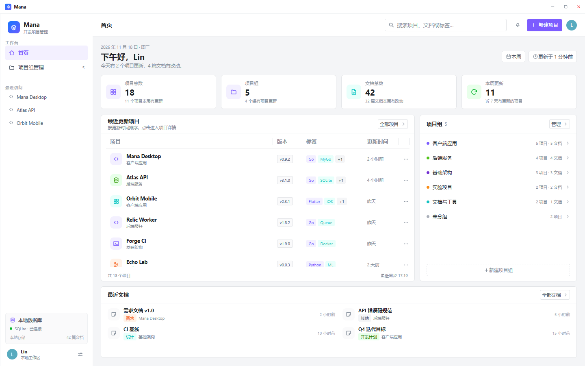
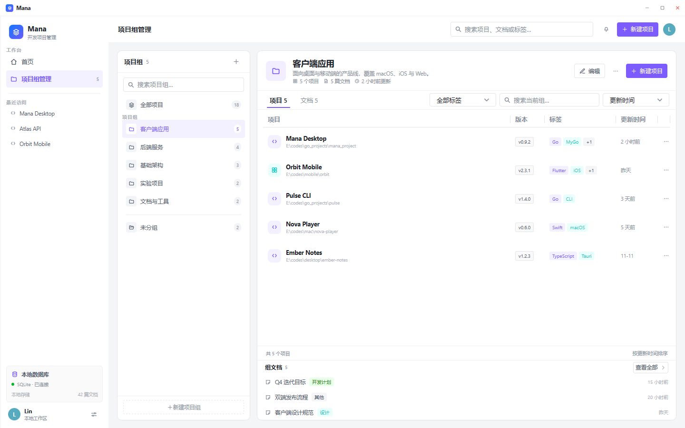
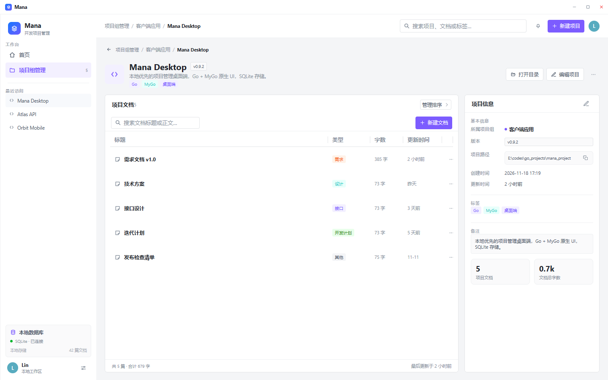
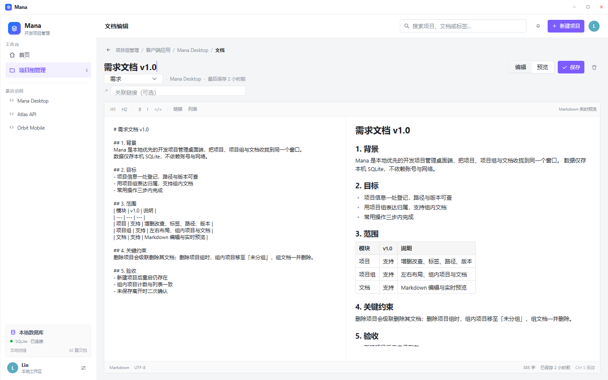
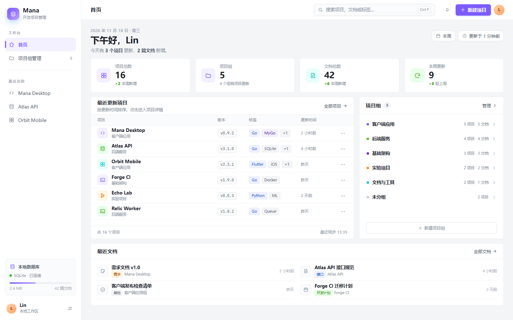
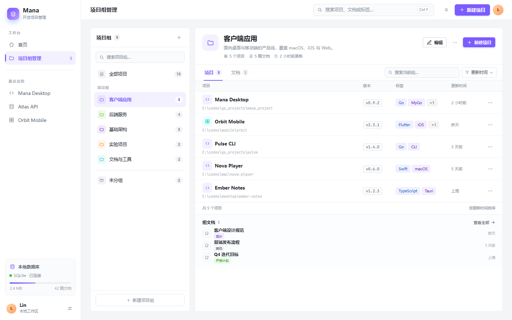
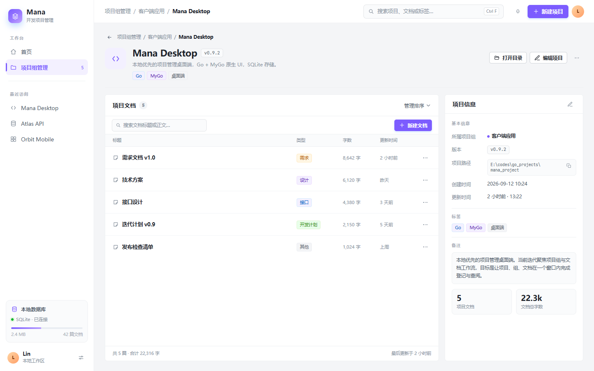
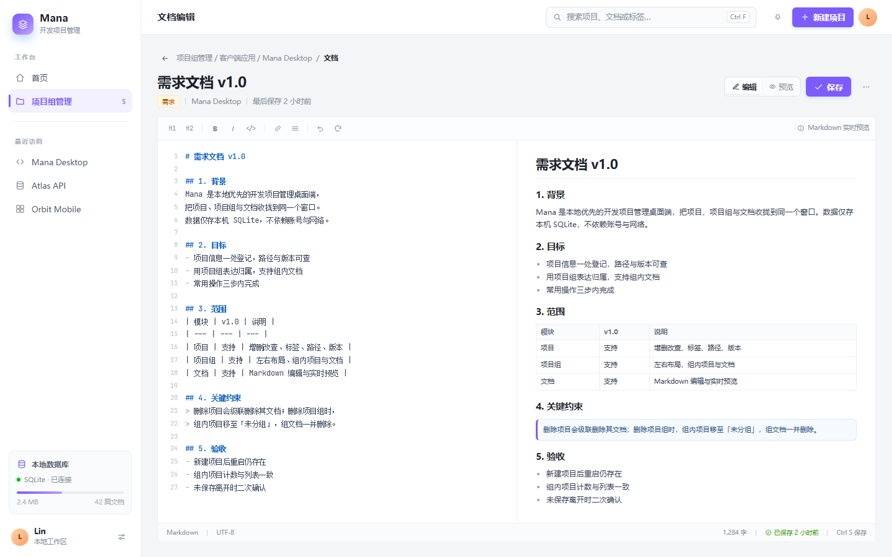

# Mana · 开发项目管理系统

本地优先的桌面项目管理工具：项目、项目组、文档在一个窗口内完成登记、归类与查阅。技术栈 **Go + MyGo 原生 UI + SQLite**，单机离线、无账号、无 cgo。

当前仓库已完成 **v1.0 的主要 P0 功能**：需求与设计文档、可运行桌面应用、SQLite 数据层、CRUD 界面、文档编辑器、无头 UI 测试与 Windows 打包产物。整体视觉为**紫罗兰主色 + 4/6px 小圆角 + 1px 边框 + 紧凑企业风**，窗口使用 MyGo 无边框标题栏。

## 实现状态

| 功能 | 状态 |
|---|---|
| 项目 CRUD（名称/标签/备注/路径/版本/所属组） | ✅ 已实现 |
| 项目组 CRUD（名称/描述/标识色） | ✅ 已实现 |
| 项目组左右布局、组内项目、组文档 | ✅ 已实现 |
| 项目详情、项目文档、Markdown 编辑 + 实时预览 | ✅ 已实现 |
| 首页统计、最近项目、项目组概览、最近文档 | ✅ 已实现 |
| 标签筛选、更新时间/名称排序、关键字搜索 | ✅ 已实现 |
| 删除二次确认（项目/组/文档级联） | ✅ 已实现 |
| 空状态、toast、快捷键（Ctrl+N / Ctrl+Shift+N / Ctrl+F / Ctrl+S） | ✅ 已实现 |
| 无边框窗口（MyGo `TitleBarHidden` + 自绘标题栏/窗口控制） | ✅ 已实现 |
| 打开目录、复制路径 | ✅ 已实现 |
| 全局搜索（项目/文档/组分组结果） | ◐ 项目过滤已实现，文档/组结果待补 |
| 设置与数据备份 | ◐ 设置入口占位，备份待补 |
| 项目组添加已有项目 / 行菜单移动 | ◐ 编辑项目时可改组，独立“移入”入口待补 |
| 深色主题 | ○ v1.1 |

## 运行

```sh
go run .            # 使用本机数据库（%AppData%\mana\mana.db）
go run . -demo      # 数据库为空时写入示例数据
go test ./...       # Store / Service / 无头 UI 测试
go tool mygo build -skip-installer -o build   # 打包 Windows 可执行文件
```

打包产物：`build/windows-amd64/Mana.exe`。`-demo` 只在数据库为空时写入示例数据，不会覆盖已有数据。

## 实现截图（同一视图的无头渲染）

| 首页 | 项目组管理 |
|---|---|
|  |  |

| 项目详情 | 文档编辑 |
|---|---|
|  |  |

最小窗口 1120×720 的截图见 [`docs/screens/`](docs/screens/)。截图由 `ui.NewTester` 无头渲染，和真实窗口使用同一套视图；实际窗口已去掉系统标题栏。

## 交付物

| 交付物 | 文件 | 说明 |
|---|---|---|
| 需求文档 | [`docs/requirements.md`](docs/requirements.md) | 背景、角色、功能需求、业务规则、数据模型、验收标准 |
| 设计说明 | [`design/README.md`](design/README.md) | 设计体系、Token、布局规格、MyGo 组件映射 |
| 可交互原型 | [`design/mana-prototype.html`](design/mana-prototype.html) | 自包含 HTML，无外部依赖；支持导航/页签/弹窗/文档编辑 |
| 设计图 | [`design/screens/`](design/screens/) | 8 张 1440×900 高保真稿（首页、项目组、文档、详情、编辑器、弹窗） |
| 开发计划 | [`docs/development-plan.md`](docs/development-plan.md) | 架构、数据层、UI 落地、测试、排期、风险、DoD |

## 设计图预览

> 2026-11 已交付**界面重设计 v2「索引卡 · INDEX」**：8 张 1440×900 设计稿、视觉规范与 MyGo 落地映射，见 [`design/README-v2.md`](design/README-v2.md)、[`design/screens-v2/`](design/screens-v2/)。现有 v1 实现与截图保持不变。

| 首页 | 项目组管理 |
|---|---|
|  |  |

| 项目详情 | 文档编辑 |
|---|---|
|  |  |

完整清单见 [`design/README.md`](design/README.md)。

## 快速查看原型

直接用浏览器打开：

```sh
start design/mana-prototype.html          # Windows
open design/mana-prototype.html           # macOS
xdg-open design/mana-prototype.html       # Linux
```

也可以带页面参数直接定位：

```
design/mana-prototype.html?screen=home
design/mana-prototype.html?screen=groups
design/mana-prototype.html?screen=groups-docs
design/mana-prototype.html?screen=detail
design/mana-prototype.html?screen=editor
design/mana-prototype.html?screen=project-modal
design/mana-prototype.html?screen=group-modal
design/mana-prototype.html?screen=delete-modal
```

原型内的侧栏导航、项目组切换、项目/文档页签、项目详情、文档编辑器和三类弹窗均可点击。

## 产品结构

```
首页
├── 概览统计
├── 最近更新项目
├── 项目组概览
└── 最近文档

项目组管理（左右布局）
├── 左栏：全部项目 / 项目组列表 / 未分组
└── 右栏：项目 / 文档
    └── 项目详情
        ├── 项目信息
        └── 文档（列表 / Markdown 编辑 / 预览）
```

核心规则：

- 项目字段：名称、标签、备注、项目路径、版本、所属项目组。
- 项目组字段：名称、描述、标识色；组内可添加项目、管理组文档。
- 删除项目级联删除其文档；删除项目组时组内项目移至「未分组」，组文档删除。
- 文档归属项目或项目组，标题在同一归属下唯一。

## 技术栈

| 层 | 选型 |
|---|---|
| 语言 | Go 1.27.3+ |
| UI | MyGo v0.9.0 原生 UI（`ui` 包，无 webview） |
| 数据库 | `modernc.org/sqlite`（纯 Go SQLite，无 cgo；替代原计划的原生插件） |
| Markdown | `github.com/egoist/mygo/ui/markdown` |
| 测试 | `go test` + `ui.NewTester` 无头渲染 |

> 原计划使用 MyGo SQLite 插件；本机无法从 GitHub 拉取原生模块（下载超时），因此改用 `modernc.org/sqlite`。SQL、schema、事务与测试完全一致，只是驱动层不同。

## 目录

```
.
├── main.go                      # 应用入口、窗口、demo 数据开关
├── mygo.json                    # 应用名称/identifier/版本
├── resources/icon.png           # 1024×1024 应用图标
├── internal/
│   ├── app/                     # MyGo UI、页面、弹窗、表单、编辑器
│   ├── model/                   # 数据结构与展示辅助
│   ├── service/                 # 校验、业务规则、错误映射
│   └── store/                   # SQLite、迁移、仓储、示例数据
├── docs/
│   ├── requirements.md
│   ├── development-plan.md
│   └── screens/                 # 实现截图（无头渲染）
├── design/
│   ├── mana-prototype.html
│   ├── README.md
│   └── screens/                 # 8 张设计稿
└── build/windows-amd64/Mana.exe # 打包产物（可重新生成）
```

## 下一步

1. 补齐 P1：全局搜索的文档结果、设置/备份、项目“移入组”菜单。
2. 增加 Markdown 关键字搜索与正文级检索。
3. 用真实用户数据做一轮验收，重点检查 IME、路径不存在、删除组级联与最小窗口。
4. 需要多平台交付时，运行 `go tool mygo build -platform darwin/universal,linux/amd64` 并做签名/公证。
